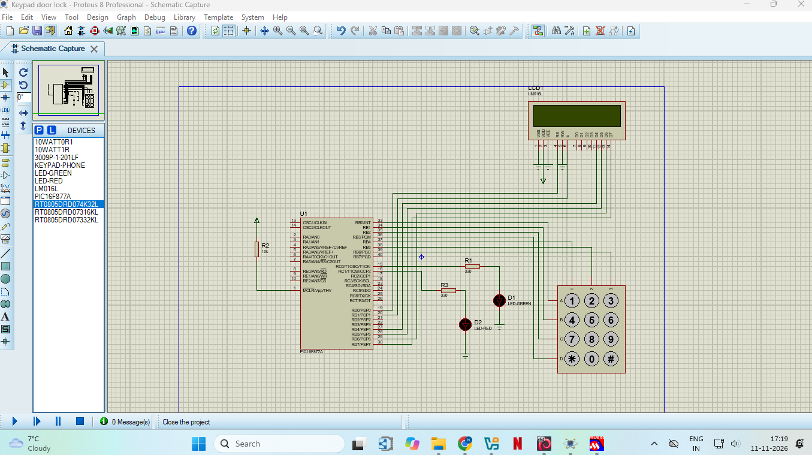
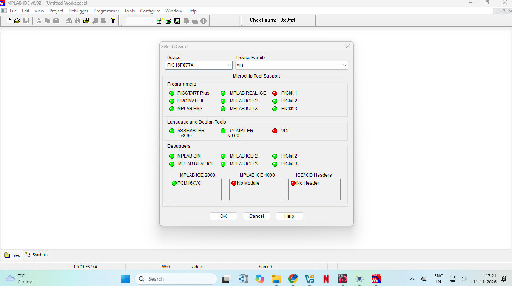
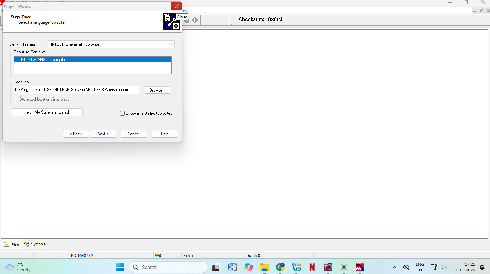
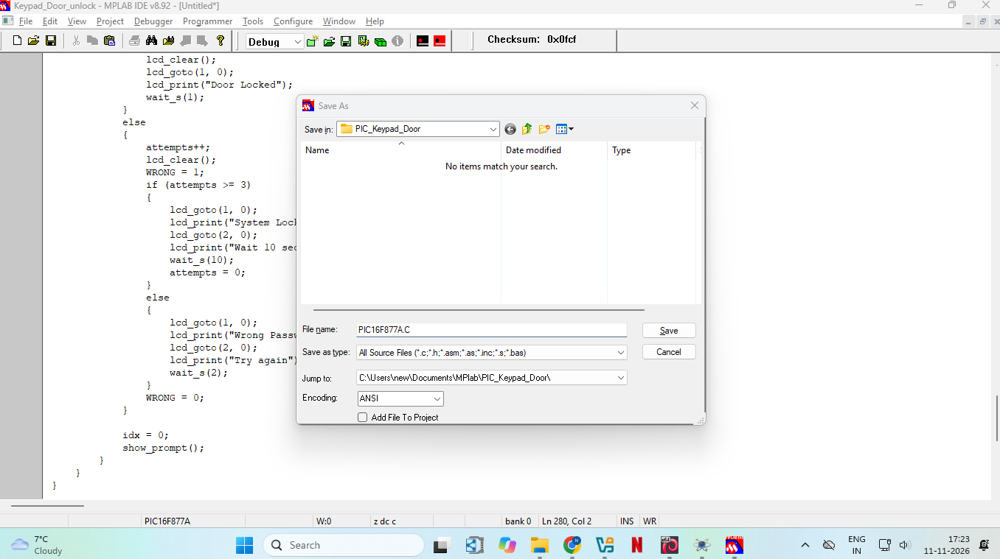
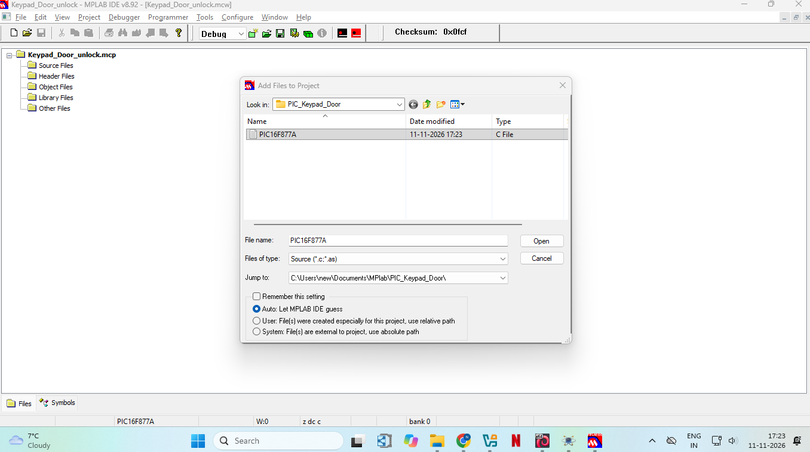
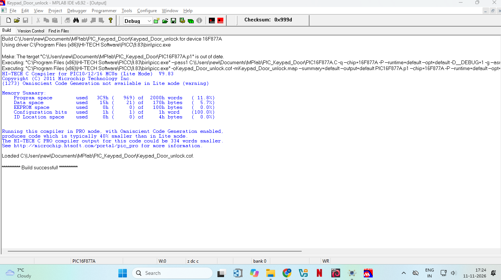
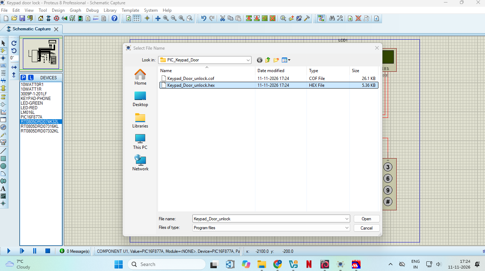
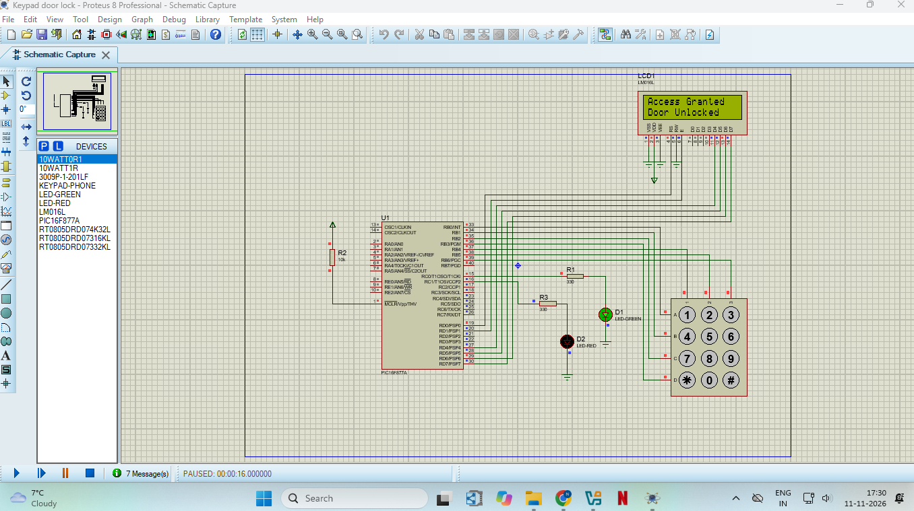

# PIC16F877A Keypad Door Lock using HI-TECH C and Proteus


## Project Overview

This project is a **keypad door lock** built around the **PIC16F877A** microcontroller. The user types a 4-digit password on a **4x3 keypad**, and a **16x2 LCD** shows the status. A correct password unlocks the door (green LED), and a wrong password raises an alert (red LED). The code is written in **Embedded C**, compiled with the **HI-TECH C compiler (PICC 9.83)** inside **MPLAB IDE v8.92**, and simulated in **Proteus 8 Professional**.

This was my second PIC project. It adds three new topics to my first one: keypad scanning, LCD interfacing in 4-bit mode, and password checking with a lockout.

## Key Features

- 4-digit password entry on a 4x3 keypad
- LCD shows `*` for each digit typed, so the password stays hidden
- Correct password: "Access Granted" and the green LED turns ON for 5 seconds
- Wrong password: "Wrong Password" and the red LED turns ON
- 3 wrong attempts in a row: "System Locked" for 10 seconds
- `*` key clears the entry, `#` key confirms it
- Software debouncing for reliable key presses
- Password can be changed easily in the source file
- Uses only 11.8% of the program memory of the PIC16F877A

## Components Required

| Component | Value | Quantity |
|-----------|-------|----------|
| PIC16F877A microcontroller (U1) | - | 1 |
| 16x2 LCD (LCD1) | LM016L | 1 |
| 4x3 keypad | KEYPAD-PHONE | 1 |
| LED (D1, door unlocked) | LED-GREEN | 1 |
| LED (D2, wrong password) | LED-RED | 1 |
| Resistor R1 (green LED) | 330 ohm | 1 |
| Resistor R3 (red LED) | 330 ohm | 1 |
| Resistor R2 (MCLR pull-up) | 10k | 1 |
| Power and ground terminals | 5V | - |

### Circuit Diagram

The circuit is drawn in Proteus 8. The keypad is connected to PORTB, the LCD to PORTD in 4-bit mode, and the two LEDs to PORTC.



### Pin Connections

| Part | Pin | PIC Pin | PIC Port Pin |
|------|-----|---------|--------------|
| Keypad | Row A to D | 33, 34, 35, 36 | RB0 to RB3 |
| Keypad | Column 1 to 3 | 37, 38, 39 | RB4 to RB6 |
| LCD | RS | 19 | RD0 |
| LCD | E | 20 | RD1 |
| LCD | D4 to D7 | 27, 28, 29, 30 | RD4 to RD7 |
| Green LED (D1) | Through R1 | 15 | RC0 |
| Red LED (D2) | Through R3 | 16 | RC1 |
| MCLR | Through R2 (10k) to VCC | 1 | MCLR |

The LCD pins VSS, VEE and RW go to GND, and VDD goes to VCC. LCD pins D0 to D3 are not connected. The cathode of each LED goes to GND.

## Source Code

The complete program is in the file `PIC16F877A.C`. It contains the LCD driver, the keypad scanning routine and the password logic.

## Setup Process

### Step 1: Select the Device in MPLAB IDE

In MPLAB IDE v8.92, click **Configure → Select Device** and choose **PIC16F877A**.



### Step 2: Create the Project

Click **Project → Project Wizard**. Choose the device PIC16F877A, select **HI-TECH Universal ToolSuite** as the language toolsuite, and finish the wizard with a project name and folder.



### Step 3: Create the C File

Create a new file, paste the program in it, and save it as `PIC16F877A.C` in the project folder.



### Step 4: Add the Source File to the Project

Right-click **Source Files** in the project window, choose **Add Files**, and select the `.C` file.



### Step 5: Build the Project

Click **Project → Build All**. The Output window should end with `Build successful!`. The build creates the HEX file `Keypad_Door_unlock.hex` in the project folder.



**Build result (HI-TECH C 9.83, Lite mode):**

| Memory | Used | Available | Percentage |
|--------|------|-----------|------------|
| Program space | 969 words | 8192 words | 11.8% |
| Data space | 21 bytes | 368 bytes | 5.7% |

### Step 6: Load the HEX File in Proteus

Double-click the PIC16F877A in Proteus, click the folder icon next to **Program File**, and select the HEX file.



Then set the following properties:

| Property | Value |
|----------|-------|
| Program File | `Keypad_Door_unlock.hex` |
| Processor Clock Frequency | 4MHz |
| Program Configuration Word | 0x3F71 |

### Step 7: Run the Simulation

Click the **Play** button at the bottom left of Proteus. The LCD shows **Enter Password:**. Click the keypad keys with the mouse to type the password.

## Output

The default password is **4444**.

| Action | LCD Display | LEDs |
|--------|-------------|------|
| Simulation starts | Enter Password: | Both OFF |
| Digits typed | `****` | Both OFF |
| Correct password, then # | Access Granted / Door Unlocked | Green ON for 5 seconds |
| Wrong password, then # | Wrong Password / Try again | Red ON for 2 seconds |
| 3 wrong attempts | System Locked / Wait 10 seconds | Red ON for 10 seconds |
| * pressed | Enter Password: | Both OFF |

### Enter Password

The LCD shows a star for each digit typed.


### Correct Password: Door Unlocked



### Wrong Password: Alert


**Demo video:** [Watch the demo](https://drive.google.com/file/d/12ORVMw5qs_UuEk3jPyZpSbe7PzM5KAyr/view?usp=drivesdk)

## How It Works

1. At start-up, the LCD is set up in 4-bit mode and shows `Enter Password:`.
2. The program scans the keypad by pulling one column LOW at a time and checking which row goes LOW.
3. After a key press, the program waits 20 ms to ignore contact bounce, then waits for the key to be released.
4. Each digit key (0 to 9) is stored, and a `*` is shown on the LCD. Up to 4 digits are accepted.
5. The `*` key clears the entry, and the `#` key checks the password.
6. If the 4 digits match the stored password, the green LED turns ON for 5 seconds and the door locks again.
7. If they do not match, the red LED turns ON and a message is shown. After 3 wrong attempts in a row, the system locks for 10 seconds.

```
Key press → debounce → store digit → press # → compare with password → unlock or alert
```

## How to Run

1. Install **MPLAB IDE v8.92** and the **HI-TECH C compiler (PICC 9.83)**.
2. Install **Proteus 8 Professional**.
3. Download or clone this repository.
4. Open `PIC16F877A.C` in MPLAB IDE, create a project for the PIC16F877A, and build it to create the HEX file.
5. In Proteus, draw the circuit shown in the Circuit Diagram section, using the pin connections table.
6. Double-click the PIC16F877A and set the Program File, clock frequency and configuration word as in Step 6.
7. Click **Play**, then click the keypad keys to enter the password.

## Important Notes

### Changing the Password

The password is stored in one line of the source file. Change the four digits, save the file, build again, and load the new HEX file.

### Keypad Pull-ups

The program uses the internal pull-up resistors of PORTB for the keypad rows. If the keys do not respond in your simulation, add a 10k resistor from each of RB0 to RB3 to VCC.

### Clock Frequency

The Processor Clock Frequency in Proteus must be **4MHz**, the same value as `_XTAL_FREQ` in the code. If the two values differ, the delays and the LCD timing will be wrong.

### Configuration Bits

The code sets the XT oscillator, watchdog timer off, power-up timer on, brown-out reset on, and low-voltage programming off. In Proteus, the Program Configuration Word 0x3F71 matches these settings.

### LCD Font in Proteus

The Proteus LM016L draws the letter `g` so that it looks like the digit 9, so "Wrong Password" can appear as "Wron9 Password". This is only how the simulated display draws the letter. The text in the program is correct.

### Real Hardware

For a real build, replace the green LED with a relay driver (a BC547 transistor, a relay and a flyback diode) to control an actual door lock. The simulation uses LEDs to show the lock state.

## Technologies and Concepts

- PIC16F877A microcontroller
- Embedded C with HI-TECH C (PICC)
- MPLAB IDE v8.92
- Proteus 8 circuit simulation
- 4x3 matrix keypad scanning
- 16x2 LCD interfacing in 4-bit mode
- Software debouncing
- Password checking and attempt lockout

## Future Improvements

- Change the password from the keypad and store it in the EEPROM
- Add a buzzer for the wrong-password alert
- Drive a real relay or solenoid lock through a transistor
- Add a longer password and a 4x4 keypad
- Build the circuit on real hardware and program the PIC with a PICkit
